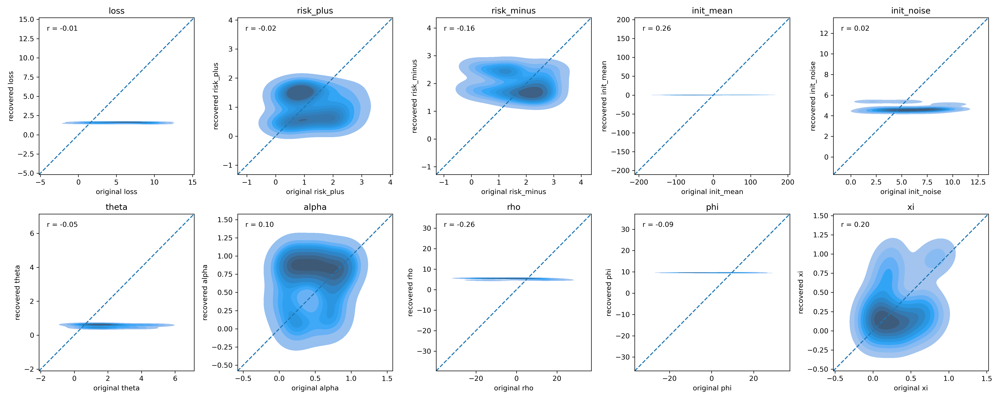
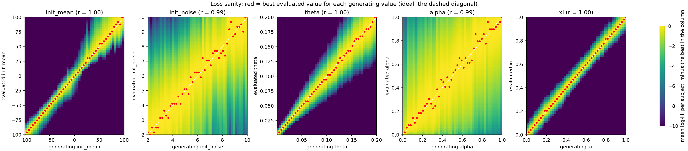
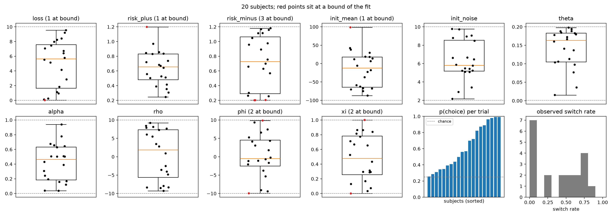

# bandit25

A prospect-theory model of exploration in a four-armed restless bandit. Agents track every arm with a
Kalman filter and choose by softmax over a prospect utility, an exploration bonus (the spread of that utility)
and a perseveration bonus. This repository simulates the model, checks that its parameters can be recovered,
and fits it to observed choices.

- [1. Task](#1-task) and [2. Model](#2-model): what is being modeled
- [3. Setup](#3-setup)
- [4. Parameter recovery](#4-parameter-recovery): can the model's parameters be identified at all?
- [5. Loss sanity](#5-loss-sanity): one parameter at a time, does the likelihood peak at the right value?
- [6. Fitting real data](#6-fitting-real-data)
- [7. Project structure](#7-project-structure)

## 1. Task
We use four-armed bandit task with 300 times of selection. Each bandit faces a decaying random walk as follows:

$\mu_{i,t+1}=\lambda\cdot\mu_{i,t}+(1-\lambda)\cdot\varphi + \nu$ with $\nu\sim N(0,\sigma_D)$, and the reward $r_t \sim N(\mu_{c_t,t}, \sigma_o)$.
The reward of the chosen bandit is sampled around its current mean with standard deviation $\sigma_o$, and every mean decays toward the center $\varphi$ with decaying parameter $\lambda$ plus the random walk $\nu$ (Daw et al., 2006), which is exactly what the Kalman filter below assumes. We use predetermined value from previous studies; $\lambda=0.9836,\sigma_o=4, \sigma_D=2.8$. To check prospect theory, the centers are $\varphi = 100, 0, -100$ (`pos`, `mix`, `neg`) and the initial means are sampled from $N(\varphi,10)$; the recovery scripts use the `mix` environments.


*One simulated agent (`scripts/simulate_data.py`): lines are the true arm means, dots the rewards it received,
and the lower panel its choices.*

## 2. Model
Using Kalman filtering, agents calculate the mean and variance of each bandit from accumulated stimuli. Then the agent randomly selects bandit using prospect theory based UCB-like model and softmax.
In summary, the response is generated as $idx \sim Softmax(\theta \cdot (u(\hat{\mu_{i, t}}^{pre}) + \phi \cdot \sigma_{i, t}^* + \rho \cdot H_{i,t}))$ for calculated mean $\mu$, exploration bonus $\phi\cdot\sigma^*$, and preservation bonus $\rho\cdot H$.
The detailed version follows:

**Learning rule**
- $\hat{\mu_{i, t+1}}^{pre} = \lambda_{env} \cdot \hat{\mu_{i, t}}^{post} + (1-\lambda_{env})\cdot \theta_{env}$
- $\hat{\sigma_{i,t+1}}^{2pre} = \lambda_{env}^2 \cdot \hat{\sigma_{i, t}}^{2post}+\sigma_d^2$

- $\hat{\mu_{c_t,t}}^{post} = \hat{\mu_{c_t, t}}^{pre}+\kappa_t\delta_t$
- $\hat{\sigma_{c_t,t}}^{2post} = (1-\kappa_t)\hat{\sigma_{c_t,t}}^{2pre}$ where $c_t$ is selected bandit
- $\kappa_t = \hat{\sigma_{i, t}}^{2pre} / (\hat{\sigma_{i, t}}^{2pre} + \sigma_o^2)$
- $\delta_t = r_t - \hat{\mu_{c_t,t}}^{pre}$


**Decision rule**
- $u(x) = \text{max}(x- \xi \cdot r_t, 0)^\alpha -\lambda \cdot \text{max}(- x + \xi \cdot r_t, 0)^\beta$
- $Softmax(\theta \cdot (u(\hat{\mu_{i, t}}^{pre}) + \phi \cdot \sigma_{i, t}^* + \rho \cdot H_{i,t}))$

- $H_{i, t} = H_{i, t-1} + \alpha_H \cdot (I_{i, t-1} - H_{i, t-1})$
- $\sigma_{i,t}^* = \sqrt{Var[u(x)]} = \sqrt{\int_{-\infty}^\infty \frac{1}{\hat{\sigma_{i,t}}\sqrt{2\pi}}e^{-\frac{1}{2}(\frac{x-\hat{\mu_{i,t}}}{\hat{\sigma_{i,t}}})^2} \cdot [u(x) - \mathbb{E}[u(x)]]^2 dx} = \sqrt{\Phi_{2\alpha}(X) + \lambda^2 \cdot \Phi_{2\beta}(X) - (\Phi_\alpha(X) - \lambda \cdot \Phi_\beta (X))^2}$
    - $\Phi_r(x) := \frac{\sigma^r}{\sqrt{2\pi}} e^{-\frac{1}{4}x^2}\Gamma(r+1)D_{-r-1}(-x)$
    - $X := (\hat{\mu_{i, t}}^{pre} - \xi \cdot r_t) / \hat{\sigma_{i, t}}^{pre}$

**Free parameters** (`free_variables['Kalman_SM']`, bounds in `recovery_range`)

| Code name | Symbol | Meaning | Range |
|---|---|---|---|
| `loss` | $\lambda$ | loss aversion | [0, 10] |
| `risk_plus` | $\alpha$ | curvature of gains | [0.2, 1.2] |
| `risk_minus` | $\beta$ | curvature of losses | [0.2, 1.2] |
| `init_mean` | $\hat{\mu}_{i,0}$ | initial estimate of every arm | [-100, 100] |
| `init_noise` | $\hat{\sigma}_{i,0}$ | initial uncertainty of every arm | [2, 10] |
| `theta` | $\theta$ | inverse temperature | [1e-3, 0.2] |
| `alpha` | $\alpha_H$ | learning rate of the preservation trace $H$ | [0, 1] |
| `rho` | $\rho$ | weight of the preservation bonus | [-10, 10] |
| `phi` | $\phi$ | weight of the exploration bonus $\sigma^*$ | [-10, 10] |
| `xi` | $\xi$ | weight of the previous reward in the reference point | [0, 1] |

$\lambda_{env}$, $\theta_{env}$ (the decay center, $\varphi$ in §1), $\sigma_o$ and $\sigma_d$ are environment constants, not free parameters.

The ranges of `risk_*`, `theta`, `rho` and `phi` are deliberately narrow. With wider ranges (risk up to 3, theta up to 5,
rho/phi up to 20) almost every simulated agent chose deterministically, and the choices then say little about the
parameters. If you widen a range, rerun the recovery (§4) before trusting fits in that range.

## 3. Setup

```bash
python3 -m venv .venv
.venv/bin/pip install --index-url https://download.pytorch.org/whl/cpu torch   # CPU build of torch; skip this line on a GPU machine
.venv/bin/pip install -e ".[test]"
source .venv/bin/activate

pytest                        # about 15 s
python scripts/make_envs.py   # data/envs/ (seed 42), used by the recovery and loss sanity scripts
```

Run every script from the repository root. Long runs print a tqdm progress bar; to keep one running after you close
the terminal, use e.g. `nohup python scripts/... > logs/run.log 2>&1 &` (`logs/` is not tracked).

## 4. Parameter recovery

Before reading anything into fitted parameters, check that the model can recover them: simulate agents with known
parameters, fit those agents' choices, and compare the fitted values with the true ones.

```bash
python scripts/recovery/vectorized_parameter_recovery.py   # about 15 min on a laptop CPU
python scripts/recovery/vectorized_visualize.py
```

What the first script does:

1. takes 30 `mix` environments from `data/envs/restless_envs` (one per simulated subject),
2. draws each subject's 10 parameters uniformly from `recovery_range` (seed 42),
3. simulates 300 choices per subject with those parameters,
4. fits all subjects at once from `recovery_init`: maximum likelihood with L-BFGS, with every parameter mapped into its
   bounds by a sigmoid (`bandit25.fitting.fit`),
5. saves `[true, fitted]` (each `(10, 30, 1)`) to `results/params/Vectorized_Restless_params`.

The second script plots fitted against true values, one panel per parameter:



Points on the dashed diagonal are recovered exactly, and `r` is their correlation. A horizontal band means the
choices do not pin that parameter down. In the current run 28 of 30 fits reach the likelihood of the true parameters,
and every parameter is recovered with r ≥ 0.57 except `init_noise` (r = 0.27): the initial uncertainty only matters in
the first few trials.

To change the experiment, edit:

| What | Where |
|---|---|
| number of subjects | `num` in `scripts/recovery/vectorized_parameter_recovery.py` |
| parameter bounds, starting point of the fit | `recovery_range`, `recovery_init` in `src/bandit25/variable.py` |
| environments | `scripts/make_envs.py`; the scripts use `restless_envs[1]`, the `mix` set |
| optimizer budget | `max_eval` of `fit` (default 200 likelihood evaluations) |

## 5. Loss sanity

A narrower check, one parameter at a time. For each of 50 generating values of the parameter, 30 subjects are
simulated with the other nine parameters fixed at random true values; their choices are then scored at each of 50
evaluated values. If the parameter is identifiable, the best evaluated value lies on the diagonal.

```bash
python scripts/loss_sanity/loss_sanity.py theta   # any parameter name; about 40 min for the 50 x 50 grid
python scripts/loss_sanity/loss_sanity_visualize.py
```

The figure shows every parameter that has a `results/params/Loss_sanity_<name>` file:



Each column is one simulated data set, so colors compare evaluated values within a column (0 = best). Red points are
the best evaluated value for each generating value; a broad yellow band means the likelihood is flat in that
parameter. With the other nine parameters at their true values, all five parameters checked so far peak on the
diagonal. `init_noise` and `alpha` have broad bands, though, which matches their weaker recovery in §4. The colors
are averages over 30 subjects, so one subject's likelihood is flatter still.

## 6. Fitting real data

### Data format

One CSV per data set, one row per trial (rows in any order):

| Column | Meaning |
|---|---|
| `subject` | subject id (number or text) |
| `trial` | trial order within the subject (e.g. 1 ~ 300) |
| `choice` | chosen arm, 0 ~ 3 |
| `reward` | reward shown on that trial, in task units |

Every subject must have the same number of trials and a choice on every trial: drop or handle missed trials before
fitting. `bandit25.data.load_choices` checks all of this and says what is wrong.

### Task constants

The Kalman filter uses the task's own constants, which are given, not fitted. They must match what the participants
played:

| Option | Meaning | Default |
|---|---|---|
| `--center` | decay center $\varphi$ of the arm means | required |
| `--noise` | observation noise $\sigma_o$ | 4 |
| `--noise-d` | drift noise $\sigma_D$ | 2.8 |
| `--lamb` | decay $\lambda$ | 0.9836 |

The parameter ranges were checked on rewards on the scale of the `mix` environments (center 0, means within about
±60). Prospect curvature depends on that scale, so for a task with another scale or center, run the recovery on
matching environments first.

### Fit

```bash
python scripts/fit_data.py path/to/choices.csv --center 0
```

All subjects are fitted together, as in the recovery: 20 subjects × 300 trials take about 15 minutes and 0.6 GB of
memory on a CPU. For final fits use `--starts 3` (or more): every extra start re-fits all subjects from random points
(`--seed`) and keeps each subject's best fit, at the cost of one more full fit per start.

The script writes to `results/fits/<csv name>/` (use `--out` for another directory):

- `params.csv`, one row per subject:
  - the 10 fitted parameters
  - `log_lik`: log-likelihood of the observed choices
  - `p_choice`: probability the model gives the observed choice, as a geometric mean over trials (0.25 is chance)
  - `bic`: $10 \ln T - 2 \cdot$ `log_lik`, for comparing model variants (lower is better)
  - `switch_rate`: fraction of trials on which the subject changed arm
  - `at_bound`: parameters that ended within 1% of a bound
- `fit.png`: the fitted parameters of all subjects, one panel per parameter, plus `p_choice` and switch rate.

### Try it on simulated data first

`simulate_data.py` writes choices of simulated agents in exactly this format, with their true parameters, so the whole
pipeline can be checked before real data arrive:

```bash
python scripts/simulate_data.py   # data/simulated/choices.csv, true_params.csv, results/figures/sample_behavior.png
python scripts/fit_data.py data/simulated/choices.csv --center 0 --true data/simulated/true_params.csv --out results/fits/simulated
```

`--true` adds `recovery.png` (fitted vs. true, as in §4). This is the output for 20 simulated subjects with one start:



19 of the 20 fits reach the likelihood of the true parameters. Subject 13 got stuck: its `phi` went to −10 (true
8.7), where the sigmoid is flat, and its log-likelihood stayed 155 below the truth. With `--starts 2` the second
start recovers it (`phi` 10.0, log-likelihood above the truth). Real data have no truth to compare with, hence
`--starts`.

### Reading a fit

- **Red points (parameter at a bound).** The bound may be too narrow for that subject, or the parameter is not
  identified for them. Widen the range in `variable.py` only together with a new recovery (§4).
- **`p_choice` near chance (0.25).** The model does not explain that subject; the subject may have chosen at random
  or used another strategy. Their parameters mean little.
- **Comparing models.** Sum `bic` over subjects for each model variant fitted to the same data.
- **Fits are local.** The first start is `recovery_init`; it reached the likelihood of the true parameters for 28 of
  30 subjects in the recovery and 19 of 20 above. A parameter stuck at the opposite bound is the typical failure;
  extra `--starts` catch it.
- **Recovery varies between samples.** With 20 to 30 subjects, `r` is noisy: `alpha` and `risk_plus` were recovered
  at r = 0.59 and 0.57 in §4 but at 0.08 and 0.16 in the simulated sample above
  (`results/fits/simulated/recovery.png`), though 19 of its 20 fits matched the truth's likelihood. Treat single-subject
  values of these two parameters with care.

## 7. Project structure

| Path | Contents |
|---|---|
| `src/bandit25/vectorized_models.py` | the model (`Vectorized_Kalman_SM`), batched over subjects |
| `src/bandit25/vectorized_function.py` | simulation and log-likelihood (`vectorized_simulate`) |
| `src/bandit25/fitting.py` | bounded maximum-likelihood fit (`fit`) |
| `src/bandit25/data.py` | reading and writing choice CSVs, task constants for fitting |
| `src/bandit25/envs.py`, `variable.py` | environment generators, parameter ranges |
| `src/bandit25/plotting.py` | recovery, fit and behavior figures |
| `scripts/make_envs.py` | generates `data/envs/*` and the sample env figures |
| `scripts/recovery/` | parameter recovery (§4) |
| `scripts/loss_sanity/` | loss sanity (§5) |
| `scripts/simulate_data.py`, `scripts/fit_data.py` | simulated data and fitting choice data (§6) |
| `notebooks/` | exploratory notebooks |
| `results/` | figures and results of the runs above |
| `tests/` | numerics, fitting, simulation and data loading (`pytest`) |
| `data/`, `logs/` | generated environments, simulated data, logs (not tracked) |

`python scripts/make_envs.py --process original` writes `data/envs/restless_envs_original` instead: the environments
used before c165b65 (same draws as the original envs.py), where the drift also takes the observation noise, so its
step SD is about 4.8 rather than $\sigma_D = 2.8$.
